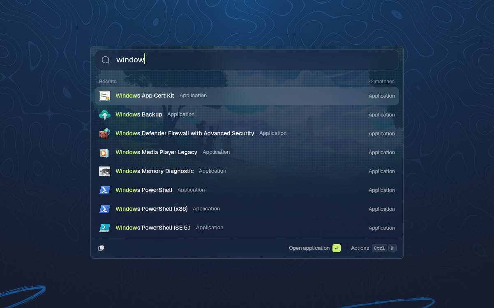

# Pane

A keyboard launcher for Windows, macOS and Linux that you extend in Rust, JavaScript or TypeScript. Inspired by Raycast and Pi.



Pane is in early development. There is no installer to download yet, so for now you build it from source.

## What it does

- Press the hotkey from any app and start typing. By default it's the Windows key on Windows, Option+Space on macOS and Ctrl+Alt+Space on Linux, and you can change it in Settings.
- Root search finds commands and apps, does arithmetic, and learns which results you pick. You can give any command an alias or a hotkey of its own.
- Everyday features are extensions you choose at first setup: Calculator, Applications, Quicklinks, Files and Clipboard History, plus Run, System Commands and Switch Windows on Windows.
- You can install more from npm, a Git repository or a folder. Pane downloads them itself, and nothing in a package runs to install it.
- In Settings you pick a light or dark theme, a glass or solid window, and a background picture of your own, with an effect such as scanlines or halftone if you like.

## Build and run

You need [rustup](https://rustup.rs). Run `rustup toolchain install` once in the repository to get the pinned toolchain (Rust 1.98.1 with the `wasm32-wasip2` target). Then, per system:

- Windows: Visual Studio Build Tools with the "Desktop development with C++" workload.
- macOS: the Xcode Command Line Tools (`xcode-select --install`).
- Linux (Debian/Ubuntu names): `libxkbcommon-dev libxkbcommon-x11-dev libwayland-dev libxcb1-dev libfontconfig1-dev libfreetype-dev libvulkan1` and a Vulkan driver (`mesa-vulkan-drivers` has a software fallback).

From the repository root:

```sh
cargo xtask guests   # build the sample extensions and dev tools into target/guests/
cargo run -p pane    # open the launcher
cargo xtask ci       # formatting, lints and tests, as CI runs them
```

On its first start Pane asks which official extensions to set up and fetches them from their GitHub repositories. [docs/building.md](docs/building.md) has the rest: packaging Pane for each system, trying the sample extensions, where Pane keeps its data and how the repository is laid out.

## Write an extension

Extensions are WebAssembly components, and the SDKs are on npm and crates.io. To start a TypeScript extension:

```sh
npm create @pane-app my-extension
cd my-extension
npm install
npm run dev
```

`npm run dev` builds the extension and hands each build to the running Pane, which reloads it as you save. Start Pane first with `cargo run -p pane`, since there's no installed copy for it to find yet.

The language and the template are options:

```sh
npm create @pane-app my-extension -- --language rust --template form
```

The templates are `list` (the default), `detail`, `form` and `no-view`. A Rust extension needs the `wasm32-wasip2` target and depends on [`pane-extension`](https://crates.io/crates/pane-extension) from crates.io (`pane-extension = "0.2"`). The npm packages are [`@pane-app/extension`](https://www.npmjs.com/package/@pane-app/extension), [`@pane-app/cli`](https://www.npmjs.com/package/@pane-app/cli) (the `pane-ext` tool) and [`@pane-app/create`](https://www.npmjs.com/package/@pane-app/create).

The [author guide](guests/README.md) covers the whole extension API, and [development mode](docs/development-mode.md) explains build-and-reload. When you're ready to share an extension, see [publishing to npm](guests/README.md#publishing-a-package-to-npm) or [publishing from a Git repository](guests/README.md#publishing-a-package-from-a-git-repository).

## Learn more

- [docs/](docs/) has a page per feature, such as [root search](docs/root-search.md), [hotkeys](docs/hotkeys.md), [appearance](docs/launcher-appearance.md) and [installing and updating](docs/installer.md).
- [CONTEXT.md](CONTEXT.md) defines the words the project uses, and [docs/adr/](docs/adr/) records the decisions behind the design.
- [docs/platforms/](docs/platforms/) records what has been tested on each system.
- The [specification](https://github.com/pane-app/pane/issues/1) and [implementation tickets](https://github.com/pane-app/pane/issues?q=is%3Aissue+label%3Aimplementation) are on GitHub Issues.
- [CONTRIBUTING.md](.github/CONTRIBUTING.md) explains how to send a change.

The background picture in the screenshot is artwork by [alinalal_](https://x.com/alinalal_/status/2017273281582449068), found on [wallhaven](https://wallhaven.cc/w/gw5ypd).

## Licence

Pane is [GPL-3.0-or-later](LICENSE-GPL). The extension contract and everything under `guests/`, including the SDKs and the samples, are [Apache-2.0](guests/LICENSE-APACHE) OR [MIT](guests/LICENSE-MIT), so the code compiled into your extension puts no licence on it. [docs/licensing.md](docs/licensing.md) has the details, including the QuickJS runtime and third-party terms.
